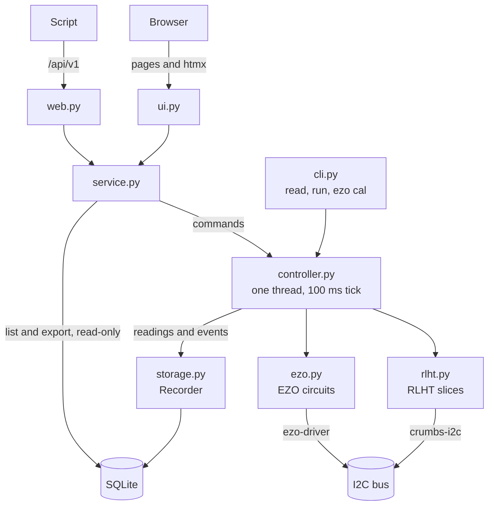

# Development

## Setting up

You need [uv](https://docs.astral.sh/uv/) and [just](https://just.systems/).
openreactor supports Python 3.11 and later.

```sh
git clone https://github.com/uwo-fast/openreactor.git
cd openreactor
just setup   # create the environment from uv.lock
just check   # format check, lint, type-check
just test    # run the tests
```

[ezo-driver](https://github.com/feastorg/ezo-driver) installs as a wheel on
x86_64 and aarch64 Linux. Elsewhere it builds from source, which needs a C
compiler.

## Recipes

`just --list` shows every recipe:

| Recipe | What it does |
|---|---|
| `just setup` | Install the locked dependencies. Run `uv lock` after you edit `pyproject.toml`. |
| `just fmt` | Format the code, and apply lint fixes. |
| `just fmt-check` | Check the formatting without changing anything. |
| `just lint` | Run ruff. |
| `just typecheck` | Run pyright. |
| `just check` | Run `fmt-check`, `lint` and `typecheck`, as CI does. |
| `just test` | Run pytest. |
| `just run ARGS` | Run openreactor, for example `just run check-config examples/openreactor.toml`. |
| `just vendor` | Download the vendored browser files and record their hashes. |
| `just build` | Build the sdist and the wheel into `dist/`. |
| `just clean` | Remove the environment, and the build and tool caches. |

## How the code fits together



- `controller.py` is the only code that touches the bus. Its thread runs
  every device operation, so other threads send it commands and get a
  `Future` back.
- `serve` runs `web.py` and `ui.py` over `service.py`. `security.py` checks
  every request first, and `errors.py` turns the service's errors into
  HTTP statuses.
- `read`, `run` and `ezo cal` build a controller in `cli.py` and use it
  directly, without the service.
- Only the controller's thread writes to the database, through the
  `Recorder` it publishes to.
- `lock.py` keeps a second `serve` or CLI command from opening the bus while
  one already has it.

## Tests

The tests run against fake devices, so they need no hardware. They cannot
show how the hardware behaves, so the hardware checks in
[bench.md](bench.md) are run by hand before a release.

CI runs `just check` and `just test` on Python 3.11 and 3.13 for every pull
request and every push to `main`.

## Pre-commit hooks

The pre-commit hooks run gitleaks, whitespace and YAML checks, and ruff. To
install them:

```sh
pre-commit install
```

The hooks skip `src/openreactor/static/vendor/`, so the vendored files stay
exactly as downloaded.

## Dependencies

Python dependencies are declared in `pyproject.toml`, pinned in `uv.lock`,
and updated by Dependabot. They are never vendored.

## Vendored browser files

The browser UI must work on a lab network with no internet, so the few
third-party browser files it needs ship inside the package, under
`src/openreactor/static/vendor/`.

[vendor.toml](../src/openreactor/static/vendor/vendor.toml) lists every file:
its package, exact version, licence, the URL it came from, and its SHA-256.
The UI's About page lists the same packages, read from that manifest. Each
package's licence file sits beside it.

Follow these rules:

- Never edit a vendored file. openreactor's own styles and scripts go in
  `src/openreactor/static/app.css` and `app.js`, which load after the
  vendored ones. `tests/test_vendored.py` fails if any file stops matching
  its recorded hash.
- Update a file by bumping its version. Change `version` in the manifest, run
  `just vendor`, and commit the downloaded files with the new hashes it
  records. The diff then shows exactly which files changed. Read the
  package's release notes before merging.
- If a patch ever becomes unavoidable, keep it as a `.patch` file beside the
  manifest, applied by `scripts/vendor.py` after each download, and record
  the reason in this section. The script does not apply patches yet.
- Stop vendoring once the UI needs a build step, such as TypeScript or
  bundling, or more than a handful of libraries. A JavaScript package manager
  with a lockfile is then the better tool. Three prebuilt files do not
  justify one.

Dependabot cannot see these files, so nothing proposes their new releases.
Check them when you work on the UI, and always when a security advisory names
one of them.

## Releasing

The [release workflow](../.github/workflows/release.yml) publishes to PyPI
with Trusted Publishing, so no API token is stored.

1. Run the hardware checks in [bench.md](bench.md), and record the results.
2. Set the version in `pyproject.toml`.
3. Push a tag `vX.Y.Z` that matches the version in `pyproject.toml`.

The workflow then:

- checks that the tag matches the version, and stops if it does not;
- builds the sdist and the wheel, and a `constraints.txt` for reproducible
  installs;
- publishes to PyPI from the `pypi` environment, where a required reviewer
  approves each upload;
- creates the GitHub release with the built files and `constraints.txt`. A
  version with `a`, `b` or `rc` in it is marked as a pre-release.

To try the same build without releasing, run the workflow by hand on `main`.
It then publishes to TestPyPI instead.
